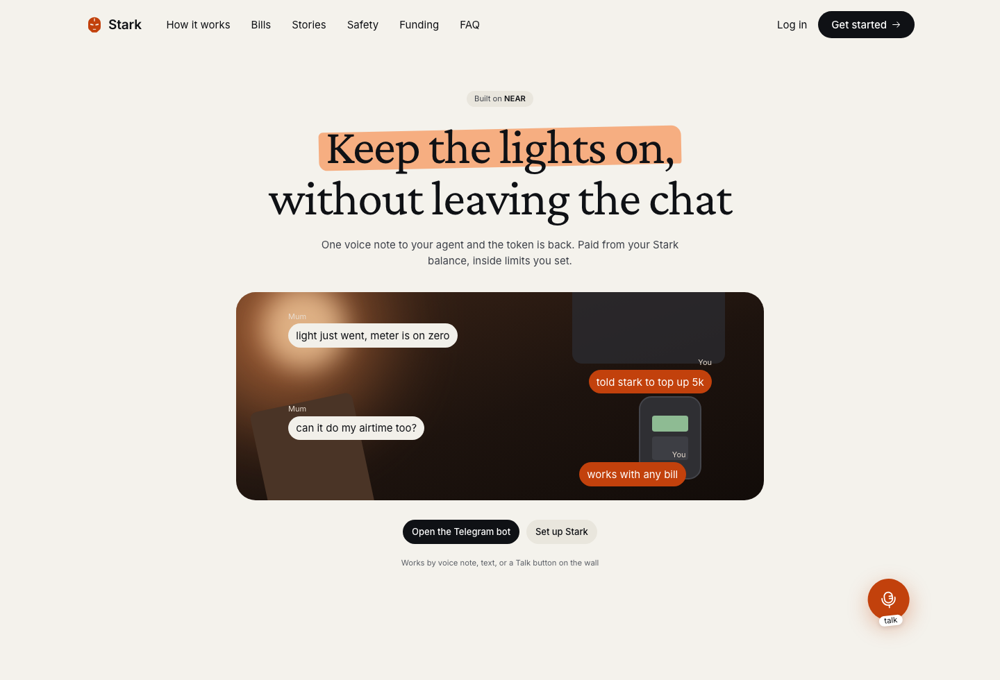
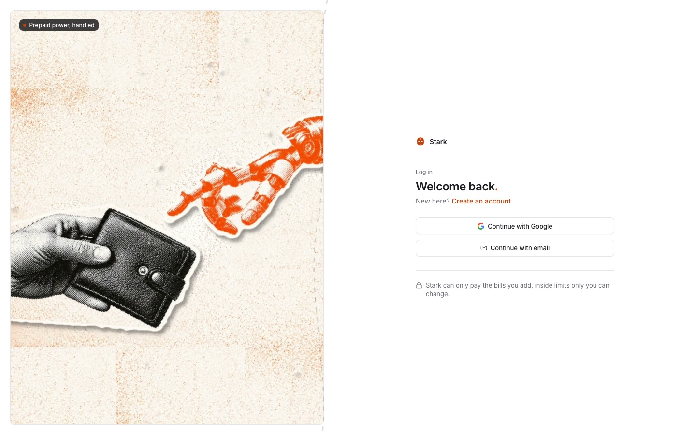

<div align="center">

# Stark

**An AI agent that pays your bills when you ask, and cannot spend past the limits you set.**

Nigerian prepaid electricity, airtime, data and TV, by text or voice, in naira.
Your money is USDC in a NEAR smart contract that holds the rules.

[**Open the app**](https://dash.hellostark.xyz) · [**Read-only demo**](https://dash.hellostark.xyz/demo) · [**Telegram bot**](https://t.me/hellostarkai_bot) · [**Website**](https://hellostark.xyz)


</div>

---

## For judges

**Tracks entered**

| Track | What in Stark answers it | Where to check |
|---|---|---|
| **Real-World Money** (lead) | USDC on NEAR pays real Nigerian bills (electricity, airtime, data, TV) in naira, by text or voice, on mainnet | The [mainnet vaults](#the-vault) and their `payment_count`; `apps/backend/app/modules/vending/` |
| **AI Security & Defense** | Spending limits live in a per-user contract, not in the prompt. The agent holds a function-call key that can only call `pay` on one vault. Payment guards run in code below the model, and the model runs in a NEAR AI Private TEE | [`policy.rs`](apps/contracts/vault/src/policy.rs), `payment_gate.py`, [Security model](#security-model) |
| **Privacy & Private AI** | The agent's model, the payment judge and voice transcription (Whisper) run on NEAR AI Cloud in a Private TEE, so the user's messages, balances and bills are read inside an enclave. A faster non-TEE model was measured and rejected | [The agent](#the-agent), [Design decisions](#design-decisions-and-trade-offs) |
| **Agent Economy** | An agent that spends for its user on real services, within limits it cannot change, and moves money across chains with NEAR Intents (1Click) | [The agent](#the-agent), [Deposits and withdrawals](#deposits-and-withdrawals) |

**Verify it in five minutes, with no account and no keys**

1. Open the read-only sample at [dash.hellostark.xyz/demo](https://dash.hellostark.xyz/demo),
   or `curl https://geddon.hellostark.xyz/v1/demo`.
2. Read a live mainnet vault. It shows real caps, a real balance and real payments:

   ```sh
   curl -s https://rpc.mainnet.near.org -H 'content-type: application/json' -d '{"jsonrpc":"2.0","id":1,"method":"query","params":{"request_type":"call_function","finality":"final","account_id":"u-fbda9ededd79777a.funder.moonboys-stark.near","method_name":"get_state","args_base64":"e30="}}' \
     | python3 -c 'import json,sys; print(bytes(json.load(sys.stdin)["result"]["result"]).decode())'
   ```

3. Confirm the agent's key can only call `pay`: the same request with
   `"request_type":"view_access_key_list"` (and no `method_name` or `args_base64`)
   returns one `FunctionCall` key, `method_names: ["pay"]`.
4. Message [@hellostarkai_bot](https://t.me/hellostarkai_bot) after signing up at
   [dash.hellostark.xyz](https://dash.hellostark.xyz) and linking the chat in the app.

## Contents

- [For judges](#for-judges)
- [Screenshots](#screenshots)
- [Why this exists](#why-this-exists)
- [What you can say](#what-you-can-say)
- [Features](#features)
- [Architecture](#architecture)
- [Anatomy of one payment](#anatomy-of-one-payment)
- [The vault](#the-vault)
- [The agent](#the-agent)
- [Telegram](#telegram)
- [Bills, naira and the float](#bills-naira-and-the-float)
- [Deposits and withdrawals](#deposits-and-withdrawals)
- [API](#api)
- [Data model](#data-model)
- [Repository](#repository)
- [Run it locally](#run-it-locally)
- [Configuration](#configuration)
- [Security model](#security-model)
- [What works today](#what-works-today)
- [Operations](#operations)
- [Design decisions and trade-offs](#design-decisions-and-trade-offs)
- [Built at NEAR HACKATHON](#built-at-near-hackathon)
- [Troubleshooting](#troubleshooting)
- [Contributing](#contributing)
- [License](#license)

---

## Screenshots



*[hellostark.xyz](https://hellostark.xyz): one voice note to your agent, and the token is back.*

| The read-only sample account | Sign in |
|---|---|
|  |  |
| [dash.hellostark.xyz/demo](https://dash.hellostark.xyz/demo): fake data, no login, a real ₦15,000 approval waiting | No passwords: Google or an email code |

---

## Why this exists

Paying for prepaid electricity in Nigeria means opening an app, remembering a 13-digit
meter number, and topping up by hand, usually at night, usually when the lights are
already out. The money part is easy; the *remembering and retyping* part is not.

Stark replaces the form with a sentence: **"top up my meter with 5,000."** It answers
questions from your real balance and your real bills, and it pays only when you ask it
to. Everything it is allowed to do sits in a contract, so a bad prompt, a bug in the
model or a leaked server key all hit the same wall.

Two rules shape the whole design:

1. **A question never spends money.** Asking "how much is left?" and paying are
   different actions, enforced in code, not in the prompt.
2. **Users never see the chain.** Balances, caps and receipts are whole naira. Adding
   money is the one place a coin appears: crypto is the default, sized in the coin the
   user names, and the rate settles the naira. The USDC,
   the vault and the chain live in this document, not in the interface.

## What you can say

| You say | Stark does | What is enforced |
|---|---|---|
| "How much can I spend this month?" | Reads the cap, this month's spend and the balance | Nothing is payable on a question turn |
| "What bills are due?" | Lists saved bills with their dates | Read-only |
| "Top up my meter with 5,000" | Prices it, checks the rules, signs `pay()` | Cap, allowlist, balance, rate |
| "Pay 15,000 for electricity" | Parks it in Approvals instead of paying | Over a cap → owner approves |
| "If I pay DStv and top up 5,000, how much is left?" | Does the arithmetic, pays nothing | Read as a question, so `pay_bill` refuses |
| "Add my MTN line, 0803…" | Saves the bill for next time | Never pays while saving |
| "Recharge my airtime" | Asks how much | No figure spoken → `amount_required` |
| "Pause everything" | Flips the kill switch | Contract `pause()` and app switch |

## Features

**For the person paying**

- Talk or type. Voice notes are transcribed with Whisper; replies can be spoken.
- Electricity, airtime, data and TV in one place, with plan pricing from the biller.
- Saved bills with short names ("Home meter"), so a number is typed once.
- Approvals: anything over a limit becomes a request you accept or deny.
- Receipts that name the bill, link the on-chain transaction, and survive a restart.
- Telegram, because that is where people already are, so no second app to install.
- One switch that stops every payment, in the app and in the contract.

**For whoever is trusting it with money**

- Caps are in the contract: monthly, per payment, per meter allowlist.
- The server's key is a function-call key that may only call `pay()` on one vault.
- The vault has no upgrade path and no full-access key, so nobody (Stark included)
  can change its code after deployment.
- Deposits are reference-checked, so a retried transfer cannot credit twice.
- A failed on-chain payment reverses itself; the USDC does not vanish.
- Rate changes are funder-only and bounded twice: by operator-set bounds in the backend,
  and on chain by the owner's ceiling and a 5% daily rise limit (vaults deployed with
  that code; earlier vaults cannot be upgraded).

**For developers**

- One typed client shared by dashboard and website (`packages/api`).
- The API contract is written down in [`docs/API.md`](docs/API.md) and frozen.
- 29 named backend test files, including the guardrails that stop a payment; Rust
  tests for every refusal the contract can produce.
- Offline by default: with no keys set, the server runs on a deterministic model and
  dry-run payments, so tests need no API keys and no money.

## Architecture

```text
                       ┌──────────────────────────┐
   browser ──────────▶ │ dashboard  (TanStack)    │
                       ├──────────────────────────┤
   Telegram ─────────▶ │ bot webhook  /v1/tg/…    │
                       └────────────┬─────────────┘
                                    │  Bearer token (Neon Auth JWKS)
                       ┌────────────▼─────────────┐
                       │  FastAPI  ·  /v1         │
                       │  auth · bills · wallet   │
                       │  approvals · control     │
                       └───┬──────────┬───────────┘
                           │          │
              ┌────────────▼──┐   ┌───▼──────────────────────┐
              │  Agent        │   │  Money loop (every 30s)  │
              │  NEAR AI TEE  │   │  deposits · float ·      │
              │  tools, not   │   │  settlements · alerts    │
              │  free text    │   └───┬──────────────┬───────┘
              └───────┬───────┘       │              │
                      │               │              │
        ┌─────────────▼───────┐  ┌────▼─────────┐  ┌─▼────────────┐
        │ Vault contract      │  │ Neon Postgres│  │ Flutterwave  │
        │ USDC · caps · keys  │  │ 19 tables    │  │ naira rails  │
        └─────────┬───────────┘  └──────────────┘  └──────┬───────┘
                  │ USDC on NEAR                         │ naira
                  ▼                                      ▼
            Stark treasury ───────────────────────▶ the biller
```

Three processes, one repo:

- **Agent**: a tool-calling loop on NEAR AI. The model chooses *which tool* to call;
  it never gets to name its own amount, its own meter or its own recipient.
- **Money loop**: a background pass that verifies open deposits, watches the
  Flutterwave float and treasury USDC, settles bills, and raises operator alerts.
- **Vault**: one contract per user. It is the only thing that can move that user's
  USDC, and it moves it only to the treasury.

## Anatomy of one payment

```text
turn 1  "top up my meter with 5,000"
  │
  ├─ 1. Snapshot: balance, cap, spend, bills, recent activity appended to the prompt
  ├─ 2. Tools: read tools withheld when the snapshot already answers them
  │        (a 1.2s answer became 2.5s otherwise). Beside the turn, a short model
  │        call reads the message: PAY, AGAIN, or not a payment
  ├─ 3. Model proposes pay_bill(bill_id, 5000)
  ├─ 4. Guards, in code (PaymentGate):
  │       read as a payment?           else not_a_payment_request
  │       plan price matches?          else plan_price_mismatch
  │       a figure was spoken?         else amount_required
  │       is it the figure spoken?     else amount_mismatch
  │       paid this minutes ago?       else duplicate_payment, unless AGAIN
  ├─ 5. Backend policy: caps, float, paused, bill ownership
  ├─ 6. Sign pay("0101…", 5000) with the vault's agent key
  ├─ 7. Contract: paused? caps? allowlist? balance? → books the payment
  ├─ 8. Contract: ft_transfer USDC to the treasury, reverse if it fails
  ├─ 9. Receipt written; Flutterwave buys the token and delivers it
  └─ 10. Reply names the bill, the amount, and links the transaction
```

Step 4 is the part that is easy to get wrong. Measured on 2026-10-24: "recharge my
airtime number" bought ₦1,000 twice, 29 seconds apart, because the model picked the
number. The guard now requires the amount to be one the user actually said, so "pay 500"
can never become ₦5,000.

## The vault

One contract per user, under the funder account: `u-<hex>.<funder>`.

| Network | Account | What it is |
|---|---|---|
| testnet | [`u-e2e541dbcb1.stark-usdc-fcb734.testnet`](https://testnet.nearblocks.io/address/u-e2e541dbcb1.stark-usdc-fcb734.testnet) | Reference vault: USDC, caps, one settled payment |
| mainnet | [`funder.moonboys-stark.near`](https://nearblocks.io/address/funder.moonboys-stark.near) | Funder and treasury; holds USDC; creates vaults |
| mainnet | [`u-312d6989246f5965`](https://nearblocks.io/address/u-312d6989246f5965.funder.moonboys-stark.near), [`u-fbda9ededd79777a`](https://nearblocks.io/address/u-fbda9ededd79777a.funder.moonboys-stark.near), [`u-278a146620c99d70`](https://nearblocks.io/address/u-278a146620c99d70.funder.moonboys-stark.near) `.funder.moonboys-stark.near` | User vaults, live since 2026-11-13; 6, 8 and 0 payments on 2026-11-14 |

**State the contract keeps** (`get_state`):

| Field | Meaning |
|---|---|
| `owner` | Who may change policy, withdraw, or approve over-cap payments |
| `funder` / `treasury` | Where deposits come from and where paid USDC lands |
| `usdc` | The NEP-141 token this vault holds |
| `usdc_per_kngn` | The naira rate, funder-set |
| `rate_ceiling`, `max_usdc_per_kngn` | The owner's rate ceiling, and the highest rate `set_rate` takes today. Only on vaults deployed from the current code; the live vaults above predate it and cannot be upgraded |
| `remaining_cap_ngn`, `spent_period_ngn`, `period_key` | What is left of the monthly cap, the month's spend, the month |
| `balance_usdc`, `balance_ngn` | What is in the vault, in both units |
| `total_paid_ngn`, `payment_count` | Lifetime totals |
| `paused` | One flag that stops all payments |

**Policy** (`get_policy`): `monthly_cap_ngn`, `per_payment_cap_ngn`, `allowed_meters`.

**Entry points** (25 in total). The ones that matter:

| Method | Who may call | Does |
|---|---|---|
| `pay(meter, amount_ngn)` | agent key or owner | Check every rule, book it, send USDC to treasury |
| `pay_approved(...)` | **owner only** | Same, with caps lifted; pause, allowlist and balance still bind |
| `ft_on_transfer(...)` | funder / treasury | Accept a deposit; a reused reference is returned untouched |
| `debit` / `on_debited` | owner | Take USDC out for a withdrawal |
| `set_rate` | funder | Set the naira rate: at most the ceiling, and at most 5% above the day's opening rate |
| `set_rate_ceiling` | owner | Cap the rate the funder may set |
| `set_policy`, `add_meter`, `remove_meter`, `pause`, `unpause`, `withdraw` | owner | Administration |
| `propose_owner` / `accept_owner` | owner / nominee | Hand a vault to the user's own account |
| `get_state`, `get_policy`, `get_payment`, `is_applied`, `can_pay` | anyone | Read-only |

**Refusals are codes, not vibes:** `paused`, `over_cap`, `over_per_payment_cap`,
`meter_not_allowed`, insufficient balance. The app maps them to plain English.

### How the limits are enforced

| Rule | How it is enforced | How to check it |
|---|---|---|
| The money is USDC in the user's own vault | Deposits arrive as NEP-141 transfers. `pay()` sends the bill's USDC to Stark's treasury, or reverses the payment if the transfer fails. | `get_state` on the reference vault, and [one settled payment](https://testnet.nearblocks.io/txns/Ho5iZ7HaB7S235FDuqw7Ar5XfCERBKq7XEdxBXeHhcR8) |
| A monthly cap and a per-payment cap, in naira | `pay()` checks both before booking | `get_policy` |
| Only listed meters can be paid | `pay()` checks the allowlist | `allowed_meters` in `get_policy` |
| The server's key can only call `pay` | Each vault has exactly one access key: a function-call key scoped to `pay` on that vault | `view_access_key_list` |
| That key cannot change the rate or the policy | Both are funder/owner-only | `tests.rs` |
| The funder cannot inflate the rate | `set_rate` refuses above the owner's ceiling or a rise of more than 5% in a day (new vaults only; the backend bounds the rate for all) | `tests.rs` |
| Nobody can change a vault's code | Code is deployed into the vault, there is no full-access key, and no upgrade method exists | `view_access_key_list` |
| An over-cap payment waits for the owner | Backend queues it; the owner calls `pay_approved()` | Approvals |
| A question is never paid | A model call reads every message as PAY, AGAIN or not a payment; anything else, or a failed call, refuses in code | `tests/test_agent.py` |
| One switch stops everything | `pause()` in the contract and in the app | Settings |

A leaked server key cannot withdraw, cannot change policy, cannot pay a different
contract, and cannot even pause: NEAR rejects an out-of-scope call as
`INVALID_TRANSACTION` before the contract runs.

Read a vault's live state with no account and no SDK:

```sh
curl -s https://rpc.testnet.near.org -H 'content-type: application/json' -d '{"jsonrpc":"2.0","id":1,"method":"query","params":{"request_type":"call_function","finality":"final","account_id":"u-e2e541dbcb1.stark-usdc-fcb734.testnet","method_name":"get_state","args_base64":"e30="}}' \
  | python3 -c 'import json,sys; print(bytes(json.load(sys.stdin)["result"]["result"]).decode())'
```

The contract is three files: [`policy.rs`](apps/contracts/vault/src/policy.rs) (the
rules), [`lib.rs`](apps/contracts/vault/src/lib.rs) (money and state) and
[`tests.rs`](apps/contracts/vault/src/tests.rs).

## The agent

A tool loop rather than a chatbot with a signing key. The model sees a state snapshot,
picks from seven tools, and the backend decides whether the resulting action is legal.

| Tool | Spends money? | Purpose |
|---|---|---|
| `get_state` | no | Balance, cap, spend, paused |
| `list_bills` | no | Saved bills and what is due |
| `recent_activity` | no | Latest receipts |
| `find_plans` | no | Priced data and TV plans |
| `pay_bill` | **yes** | Pay one bill an exact naira amount |
| `add_bill` | no | Save a bill for later |
| `add_money` | no | Start a deposit (crypto or bank) |

**Models.** NEAR AI Cloud, in a Private TEE. The default is
`Qwen/Qwen3.6-35B-A3B-FP8`: 1.4s a turn, measured 2026-11-13, with the same tool calls
as slower models on a six-turn probe. Same day, same prompt:

| Model | Time per turn | Note |
|---|---|---|
| `Qwen/Qwen3.6-35B-A3B-FP8` | 1.4s | Default |
| `google/gemini-2.5-flash-lite` | 1.4s | Not a TEE model; claimed a deposit had arrived when it had only started |
| `deepseek/deepseek-v4.1-flash` | 2.9s | |
| `Qwen/Qwen3.8-27B` | 17.9s | Single turns reached 81s |

Voice in is `openai/whisper-large-v3`. Voice out is ElevenLabs Flash when keyed,
plain text otherwise. A question takes 2–3 seconds; a payment 5–15, because it makes
several tool calls.

**Latency is a design constraint, not an accident.** The state snapshot (~2KB) is
cheaper than a round trip, so it is appended to the prompt and the read tools are
withheld. If the snapshot fails, every tool comes back: a wrong number is worse than a
slow one.

**The prompt is not a security boundary.** Every rule that matters is re-checked below
the model: amounts must be spoken, plan prices must match, a question is refused,
and the contract re-checks caps and the allowlist on chain regardless.

## Telegram

The bot exists so Stark lives where the bill does, a chat you already have open with a
voice note button, instead of a web app you have to remember to open.

- **One door, one brain.** `@hellostarkai_bot` calls the same agent, the same tools and
  the same vault as the web app. There is no second implementation and no second balance.
- **Linking is explicit.** The app issues a short code (`POST /v1/link/code`); sending
  it to the bot binds that chat to that account. Unlinked chats get nothing, not even a
  balance, and a code expires and is attempt-limited.
- **Nothing is shared by default.** A code links one chat. `GET /v1/link/identities`
  lists what is linked; `DELETE` unlinks it.
- **Voice notes work.** Telegram's audio is fetched, transcribed, and answered on the
  same path as browser voice.
- **Reminders go to the right chats.** Renewal reminders are per account, about that
  account's own bills, to that account's linked chats. There is no bot owner.
- **Replay-safe.** `processed_messages` records update IDs, so a retried webhook cannot
  pay twice. The webhook refuses everything until both the bot token and the secret are
  set.
- **Buttons, not typing.** A linked chat gets a menu (Balance, Add money, Pay a bill,
  Recent payments). A crypto deposit arrives with the address and amount in
  tap-to-copy text and Copy buttons, and no naira; a bank deposit is a Pay button. A
  question with fixed answers (which network?) shows them as buttons, and a tap goes
  through the same checks as typed text.

The bot is a channel adapter, nothing more: `app/modules/telegram` and the web app's
Talk screen share one turn pipeline.

## Bills, naira and the float

Billers in Nigeria take naira, not USDC, so the last mile is off chain by necessity:

```text
user's vault ──USDC──▶ Stark treasury ──Flutterwave──▶ biller ──token/SMS──▶ user
```

- **Flutterwave** is the only naira provider: bill payments, deposits (bank transfer,
  card, USSD), withdrawals and the bill catalogue.
- **The float** is Stark's Flutterwave naira balance. A deposit is spendable at once but
  reaches the float only when Flutterwave settles it, so a payment the float cannot
  cover is refused with `float_low` **before anything is signed**.
- **Operator alerts** fire on the admin page when the float drops below
  `STARK_FLOAT_LOW_NGN`, when treasury USDC drops below `STARK_TREASURY_LOW_USDC`, or
  when coverage goes negative.
- **Card money is held** (`STARK_CARD_HOLD_HOURS`, default 72) because a card charge can
  be disputed after the cash is gone. Bank transfer and USSD are not held.
- **Webhooks plus a poller.** `/v1/flutterwave/webhook` verifies with `FLW_SECRET_HASH`;
  the money loop also verifies each open deposit, so local runs work with no public URL.

## Deposits and withdrawals

- **Deposits** use NEAR Intents (1Click), mainnet only. A quote is created, the user
  sends to the returned address, and the money loop credits the account.
- **The rate** is Paycrest's live naira/USDC rate with Stark's spread each way. It is
  bounded: outside `STARK_USDC_RATE_MIN..MAX`, or moving more than
  `STARK_USDC_RATE_MAX_MOVE`% from the last accepted rate, it is refused. The last good
  rate covers 15 minutes.
- **Withdrawals** go either to a Nigerian bank account (Flutterwave transfer, with
  account-name resolution and daily limits) or as USDC through a 1Click swap.
- Crypto withdrawals need a **full-access treasury key** (`ft_transfer` requires a
  1-yocto deposit that a function-call key cannot attach), so the treasury balance is
  kept small and every withdrawal has a cap.

## API

Base URL: `https://geddon.hellostark.xyz`. Every `/v1` route except `/v1/demo` and the
Telegram webhook needs `Authorization: Bearer <Neon Auth token>`. The contract is
[`docs/API.md`](docs/API.md).

| Group | Routes |
|---|---|
| Sample | `GET /v1/demo`: read-only account, no sign-in |
| State | `GET /v1/state`: everything the dashboard needs in one call |
| Bills | `GET/POST /v1/bills`, `GET/PATCH/DELETE /v1/bills/{id}`, `POST /v1/bills/{id}/confirm` |
| Payees | `GET /v1/payees`, `GET /v1/plans`, `GET /v1/suggestions` |
| Money | `GET /v1/wallet`, `/methods`, `/rates`, `/crypto-assets`; `POST /v1/wallet/topup` |
| Deposits | `POST /v1/wallet/deposits`, `/preview`; `GET /v1/wallet/deposits[/{id}]`; `POST …/{id}/tx` |
| Withdrawals | `GET /v1/wallet/banks`; `POST /bank-accounts/resolve`, `/withdraw`, `/withdraw/crypto`; `GET /withdrawals` |
| Payments | `POST /v1/payments`, `GET /v1/activity` |
| Limits | `GET/PATCH /v1/limits` |
| Approvals | `GET /v1/approvals`, `POST /{id}/approve`, `POST /{id}/deny` |
| Control | `GET /v1/controls`, `POST /pause`, `POST /resume` |
| Voice | `POST /v1/voice`, `POST /v1/speak`, `/speak/ticket`, `GET /speak/stream` |
| Telegram | `POST /v1/link/code`, `GET /v1/link/identities`, `DELETE /{channel}/{id}`, `POST /v1/tg/webhook` |
| Operator | `GET/PATCH /v1/admin/*` (`X-Stark-Admin-Key`), `GET /v1/turnlog` |
| Ops | `GET /` and `GET /health`, `POST /v1/telemetry` |

Swagger is **local only** (`STARK_DOCS=1` → `/docs`, `/redoc`, `/docs/openapi.json`).
Production serves no spec, deliberately. Error bodies are
`{code, message, detail}`; codes are stable and documented, e.g. `unauthorized`,
`float_low`, `over_cap`, `rate_limited` (with `retry_after_seconds`).

## Data model

Neon Postgres, 19 tables, created on first boot, additive by policy:

`accounts` · `wallets` · `bills` · `receipts` · `account_limits` · `payment_requests` ·
`vaults` · `vault_payments` · `chain_ops` · `deposits` · `withdrawals` · `bank_lookups` ·
`channel_identities` · `link_codes` · `link_attempts` · `processed_messages` ·
`telemetry` · `settings` · `operator_alerts`

Money is stored as integer naira. There are no floats. Chain writes go through
`chain_ops` so a retried operation is idempotent.

## Repository

| Path | Contents | Stack |
|---|---|---|
| [`apps/contracts`](apps/contracts) | The vault: USDC, caps, allowlist, pause, payment records | Rust, near-sdk |
| [`apps/backend`](apps/backend) | API, agent, bill payment, Telegram, voice, money loop, 30 modules | Python, FastAPI |
| [`apps/dashboard`](apps/dashboard) | The app people use | TanStack Start + Query |
| [`apps/website`](apps/website) | Marketing site, pre-rendered | React Router |
| [`packages/ui`](packages/ui) | Design system | shadcn/ui on Base UI, Tailwind v4 |
| [`packages/api`](packages/api) | Typed client for `/v1` | TanStack Query |
| [`docs`](docs) | [`API.md`](docs/API.md) contract, [`FRONTEND.md`](docs/FRONTEND.md), [`HANDOFF.md`](docs/HANDOFF.md) engineering log | |

**Best entry points into the code**

- The rules: `apps/contracts/vault/src/policy.rs`, then `pay()` in `lib.rs`.
- The agent: `Agent.respond` and `_tools_for` in `apps/backend/app/modules/agent/agent.py`.
- The guards: `PaymentGate` in `payment_gate.py` (question check, plan price, spoken
  amount, repeats, limits), and the payment judge in `payment_intent.py`.
- Signing: `apps/backend/app/modules/chain/near_tx.py` and `vault_chain.py`.
- The money loop: `apps/backend/app/modules/payment/`, `treasury/`, `liquidity/`.

## Run it locally

**Prerequisites:** Node 22+, Bun 1.3+, Python 3.9+. Rust only if you change the
contract.

```sh
bun install
cd apps/backend && bun run setup && cd ../..   # Python venv for the API
bun dev                                       # website :5173, dashboard :5174, API :8000
```

The API needs `DATABASE_URL` (Neon pooler URL; the schema creates itself) and
`NEON_AUTH_BASE_URL` (the same branch's Auth URL). The team keeps both in Infisical:
`infisical login` once, and the `dev` scripts load them.

**With nothing else set, the server runs offline:** payments are dry runs, nothing
reaches a chain, and a deterministic model stands in for the LLM. That is the default
developer experience and what the test suite uses.

**Contract**

```sh
cd apps/contracts/vault
cargo test                                   # every refusal the contract can produce
cargo near build non-reproducible-wasm
```

Deploying a vault on testnet points `STARK_VAULT_CODE` at the wasm (~2 NEAR of storage
per user). On mainnet the code is published **once** as a global contract and vaults
reference `global:<funder>`:

```sh
python -m app.modules.chain.vault_chain publish ../contracts/vault/target/near/stark_vault.wasm
```

**Smoke test** (needs a running API):

```sh
bun check    # typecheck, lint, backend unit tests
bun smoke    # end-to-end checks against a running API
```

## Configuration

Everything is optional except the two Neon values; all of it is documented inline in
[`apps/backend/.env.example`](apps/backend/.env.example). The shape:

| Variable | Effect when unset |
|---|---|
| `DATABASE_URL`, `NEON_AUTH_BASE_URL` | **Required**: the server refuses to start |
| `NEAR_AI_API_KEY`, `NEAR_AI_MODEL`, `NEAR_AI_STT_MODEL` | Deterministic model, no voice |
| `ELEVENLABS_API_KEY` (+ voice/model IDs) | Replies are text |
| `FLW_SECRET_KEY`, `FLW_SECRET_HASH`, `STARK_APP_URL` | Nothing can be sold or withdrawn (501); test top-ups only |
| `STARK_FUNDER_ACCOUNT`, `STARK_FUNDER_KEY`, `STARK_AGENT_KEY`, `STARK_VAULT_CODE` | Payments book off chain, as they always did offline |
| `STARK_NETWORK`, `STARK_USDC_TOKEN`, `STARK_BROADCAST` | testnet, `usdc.fakes.testnet`, broadcast off |
| `STARK_TREASURY_NEAR_ACCOUNT`, `STARK_TREASURY_KEY`, `ONECLICK_API_KEY` | Crypto deposits/withdrawals off |
| `TELEGRAM_BOT_TOKEN`, `TELEGRAM_WEBHOOK_SECRET` | The webhook refuses every request |
| `STARK_ADMIN_KEY` | Every admin request is refused (under 32 chars: no start) |
| `STARK_DOCS=1` | No Swagger, no ReDoc, no spec |
| `STARK_STUB_RESET=1` | `POST /v1/_stub/reset` is 404 |

Operator limits (caps, holds, thresholds, rate bounds, rate limits) are set on
`/admin → Limits` and apply within 15 seconds without a deploy. The env var is only the
default.

## Security model

| Threat | What stops it |
|---|---|
| Prompt injection asks for a bigger payment | Amount must be spoken; plan price must match; caps and allowlist are re-checked on chain |
| The model invents a payee | The contract pays from your vault to the treasury only; the biller is chosen by the backend, not the model |
| A leaked agent key | Function-call key scoped to `pay` on one vault, with a NEAR allowance; no withdraw, no policy, no rate |
| A leaked backend session | Every `/v1` route checks a Neon Auth token against the provider's JWKS |
| Malicious vault code | No upgrade method, no full-access key, so the deployed code is the code |
| Replayed deposit | Each deposit's reference is applied once; a repeat is returned untouched |
| Dust/storage attack on a vault | Only funder and treasury may deposit, with a bounded `msg` |
| Replayed Telegram update | `processed_messages` on update ID |
| Charged-back card money | Card funds are held 72h before withdrawal |
| Operator fat-fingers a rate | Rate is bounded and bounded per move; stale rates expire in 15 minutes; on chain, the owner's ceiling and a 5% daily rise limit |

**Honest caveats**

- On mainnet, each vault's `owner` is currently the funder account, not the user's own
  account. `propose_owner`/`accept_owner` exists but has not been run, so owner powers
  (policy, withdraw) sit with the team. The spend rules that protect the user are not
  owner powers, and they bind the owner too via `pay_approved`, but this is worth
  knowing before handing someone a vault.
- The treasury holds a full-access key for crypto withdrawals and refunds. It is capped
  and kept small, but it is a hot key.
- The float is a custodial balance at Flutterwave by necessity, not by preference.

## What works today

Last checked **2026-11-14**, against `main` and the live deployments.

| Part | State |
|---|---|
| Vault contract | **Live.** Testnet reference vault holds USDC with real caps: monthly and per-payment caps, an allowlist, one settled payment, over-cap and unlisted-meter payments refused. |
| Mainnet | **Live.** `funder.moonboys-stark.near` is funder and treasury and holds USDC. Three user vaults have real contract code, a single `pay`-only key each, funded USDC balance and live policies. |
| Agent | **Live.** NEAR AI in a Private TEE; Whisper for voice. 2–3s a question, 5–15s a payment. |
| Web app | **Live** at [dash.hellostark.xyz](https://dash.hellostark.xyz), with a read-only sample at [/demo](https://dash.hellostark.xyz/demo). |
| API | **Live** at `geddon.hellostark.xyz` (`/health`). Swagger is local only. |
| Sign-in and storage | **Live.** Neon Auth; one wallet and one receipt trail per account in Neon Postgres. |
| Telegram | **Live** as [@hellostarkai_bot](https://t.me/hellostarkai_bot), text and voice notes. |
| Bill payment in naira | **Live.** The production IP is whitelisted at Flutterwave, and real bills have been paid end to end in production: USDC out of the vault on chain, naira to the biller, the token or confirmation back in the receipt. |
| Crypto deposits | **Live.** Real deposits have completed through NEAR Intents (1Click) on mainnet and been credited to the user's vault. |

## Operations

- **`/admin`**: float, treasury, coverage, alerts, limits, fees, pots. Needs
  `X-Stark-Admin-Key`.
- **Operator limits**: caps, holds, thresholds, rate bounds, per-minute rate limits.
  Live within 15 seconds, no deploy.
- **Turn log**: `STARK_TURN_LOG=1` writes one JSON line per turn (transcript, reply,
  actions, per-stage timings) plus the uploaded clip; read it at `GET /v1/turnlog`.
- **Alerts**: low float, low treasury, negative coverage, raised to the admin page and
  cleared when they recover.

## Design decisions and trade-offs

- **Why a contract per user at all?** Because "the agent cannot overspend" is only true
  if the limit lives somewhere the agent cannot write. A shared ledger would put the
  rules back in the backend.
- **Why naira in the contract?** Users think in naira. The contract stores the rate and
  caps in naira and converts once, at payment time, so rounding happens in one place.
- **Why USDC, not a naira stablecoin?** USDC on NEAR is liquid and has a real treasury
  flow; billers still need naira, so the swap happens once, off chain.
- **Why Telegram?** The bill arrives in a chat, so the agent should live there too. It
  costs one webhook and reuses the whole turn pipeline.
- **Why is the model not a TEE requirement?** It is: the default model is served in a
  Private TEE. A faster non-TEE model was measured and rejected.
- **Cost.** A per-user vault costs ~2 NEAR of storage on testnet; on mainnet the code is
  published as a global contract so each vault pays only for its own state.
- **What we did not build.** No card issuance, no credit, no multi-user households, no
  on-chain biller registry. Each is a real product; none is needed for the demo.

## Built at NEAR HACKATHON

Everything here was written during the hackathon: first commit **2026-10-20**, the day
after the announcement. No code comes from an earlier project. Tracks: **Real-World
Money** (lead), **AI Security & Defense**, **Privacy & Private AI**, **Agent Economy** (see
[For judges](#for-judges)).

**Libraries and services**

| Part | Used for |
|---|---|
| near-sdk (Rust) | The vault contract |
| FastAPI and pydantic | The API |
| React, TanStack Start, Router and Query | The web app |
| Tailwind v4 and shadcn/ui on Base UI | The design system |
| NEAR AI Cloud | The agent's model and Whisper transcription, in a Private TEE |
| NEAR Intents (1Click) | Crypto deposits and withdrawals |
| Neon | Postgres and sign-in |
| Flutterwave | Naira: bill payments, bank deposits and withdrawals |
| ElevenLabs | Spoken replies |
| Telegram Bot API | The Telegram bot |

AI coding assistants were used.

## Troubleshooting

| Symptom | Cause |
|---|---|
| `Address already in use` | An old process holds the port: `lsof -nP -iTCP:8000 -sTCP:LISTEN` |
| Every request is 401 | Not signed in, or `NEON_AUTH_BASE_URL` belongs to a different Neon branch than `DATABASE_URL` |
| Dashboard shows no data | The API is not on `127.0.0.1:8000` |
| `Please enable IP Whitelisting` from Flutterwave | This machine's IP is not on the dashboard's list, test mode included |
| Payments succeed but no token | The biller call failed or is still pending: check the receipt's status and the Flutterwave logs. Locally, with no Flutterwave keys set, payments are dry runs |
| `float_low` | The Flutterwave float has not settled; see `/admin` |
| `/docs` is 404 | Expected in production; run locally with `STARK_DOCS=1` |

## Contributing

See [`CONTRIBUTING.md`](CONTRIBUTING.md). Ground rules:

- Money in the app is whole naira, stored as integers. No floats.
- What users see has no crypto terms. Chain detail belongs in docs like this one.
- [`docs/API.md`](docs/API.md) is frozen; changes may only add to it.
- Never commit secrets.

## License

MIT. See [`LICENSE`](LICENSE).
